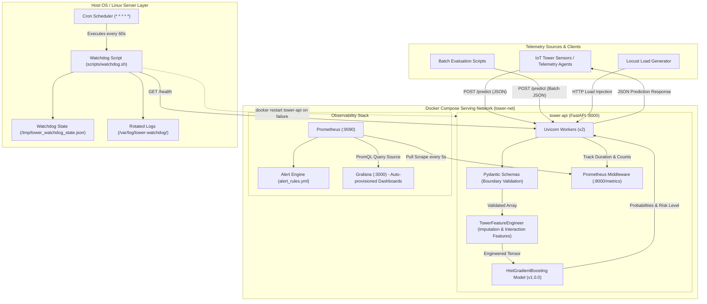

# Tower-Failure Model Serving Stack: Deployed, Load-Tested and Monitored

[](https://www.python.org/downloads/release/python-3110/)
[](https://fastapi.tiangolo.com/)
[](https://docs.docker.com/compose/)
[](https://prometheus.io/)
[](https://grafana.com/)
[](tests/test_parity.py)

An end-to-end Machine Learning Operations (MLOps) serving stack designed to predict mobile telecommunications cell tower failures within a 48-hour operational window based on multivariate sensor telemetry. The stack encapsulates feature engineering, low-latency API serving, container orchestration, metrics scraping, live Grafana dashboards, automated Prometheus alerting, empirical load-testing benchmarks, and an automated self-healing Linux watchdog.

---

## Table of Contents

- [1. Project Overview](#1-project-overview)
- [2. System Architecture](#2-system-architecture)
- [3. Technology Stack](#3-technology-stack)
- [4. Repository Structure](#4-repository-structure)
- [5. Prerequisites and Setup](#5-prerequisites-and-setup)
- [6. Service URLs and Verification](#6-service-urls-and-verification)
- [7. API Documentation and Contracts](#7-api-documentation-and-contracts)
- [8. Model Training and Reproducibility](#8-model-training-and-reproducibility)
- [9. Monitoring and Alerting](#9-monitoring-and-alerting)
- [10. Load Testing and Performance Optimization](#10-load-testing-and-performance-optimization)
- [11. Watchdog, Cron, Logging, and Permissions](#11-watchdog-cron-logging-and-permissions)
- [12. Deployment (Local vs. Remote)](#12-deployment-local-vs-remote)
- [13. Troubleshooting](#13-troubleshooting)
- [14. Limitations and Future Improvements](#14-limitations-and-future-improvements)
- [15. Project Documentation and Test Verification](#15-project-documentation-and-test-verification)
- [16. License and Acknowledgements](#16-license-and-acknowledgements)

---

## 1. Project Overview

### Problem Statement
Cellular base transceiver stations (towers) are deployed across geographically distributed and harsh outdoor environments. Unplanned tower outages degrade voice and broadband connectivity for thousands of subscribers and require emergency, off-hours field engineering dispatches. By continuously analyzing sensor telemetry (temperature, battery voltage, power draw, signal strength, fan speed, humidity, traffic load, and physical age), telecom operators can predict failures up to 48 hours in advance, shifting maintenance from reactive emergency recovery to proactive scheduled servicing.

### Complete MLOps Workflow
1. **Model Preparation**: Zero-skew preprocessing (`TowerFeatureEngineer`) with median imputation and domain interaction features, trained using `HistGradientBoostingClassifier` with balanced loss weighting for class-imbalanced data.
2. **Low-Latency Serving**: FastAPI microservice exposing single and batch inference endpoints (`/predict`) with strict Pydantic v2 input validation and boundary checks.
3. **Container Orchestration**: Multi-container Docker Compose deployment managing the API, Prometheus metrics collector, and Grafana dashboard.
4. **Observability & Alerting**: Real-time Prometheus metrics scraping every 5 seconds, auto-provisioned Grafana visualizations, and two production alert rules (`HighLatencyP95` and `HighFailurePredictionSpike`).
5. **Empirical Benchmarking**: Locust load tests across 10, 100, and 500 concurrency levels, identifying memory allocation bottlenecks and applying NumPy vectorization to achieve a +42% throughput gain under peak load.
6. **Linux Operations & Reliability**: Autonomous Bash watchdog script with anti-restart loop prevention, log rotation, and group-based permission policies.

### Key Features
- **Strict Boundary Validation**: Prevents model crashes or silent corruptions from anomalous telemetry using HTTP 422 boundary guards.
- **Identical Training & Serving Preprocessing**: Reusable feature transformer module shared directly between `src/train.py` and `src/app.py` to prevent training-serving skew.
- **Fast Vectorized Inference**: Array preallocation bypassing per-request DataFrame creation overhead.
- **Fully Automated Provisioning**: Dashboards, Prometheus data sources, and alert rules mount declaratively on container startup with zero manual UI setup.
- **Watchdog**: Checks API health, attempts a container or local-process restart after a failed check, polls for recovery for up to 30 seconds, and limits repeated restart attempts. This is a configured recovery window, not a guarantee that every failure recovers within 30 seconds.

---

## 2. System Architecture

The following diagram illustrates the complete data flow, from inbound telemetry to model inference, metrics aggregation, monitoring, and automated operational recovery:



### Component Roles
- **FastAPI Serving Service (`tower-api`)**: Serves prediction requests over HTTP, runs 2 Uvicorn workers, validates inputs via Pydantic, and tracks request counters and latency histograms in-memory.
- **Prometheus (`tower-prometheus`)**: Scrapes the `/metrics` endpoint every 5 seconds, calculates sliding rate windows, evaluates alert rules, and exposes time-series data.
- **Grafana (`tower-grafana`)**: Loads the repository dashboard definition with five operational panels through the configured Grafana provisioning setup.
- **Watchdog (`scripts/watchdog.sh`)**: Runs via cron on the Linux host, queries the `/health` endpoint every minute, logs status with ISO-8601 timestamps, automatically restarts degraded containers, and stops after 3 consecutive failures.

---

## 3. Technology Stack

This repository uses only the following tools and libraries:

| Category | Technology | Version | Purpose in Repository |
| :--- | :--- | :--- | :--- |
| **Language** | Python | 3.11-slim | Runtime for application, training, tests, and benchmarks |
| **Web Framework** | FastAPI | 0.161.1 | High-performance asynchronous serving framework |
| **ASGI Server** | Uvicorn | 0.54.0 | ASGI production server running multiple worker processes |
| **Data Validation** | Pydantic | 2.14.1 | Schema parsing and strict physical boundary validation |
| **Machine Learning**| scikit-learn | 1.9.0 | Model pipeline and `HistGradientBoostingClassifier` |
| **Numerical/Data** | NumPy | 2.4.6 | Vectorized inference matrix construction |
| **DataFrames** | pandas | 3.0.5 | Batch dataset ingestion and benchmark analysis |
| **Model Storage** | joblib | 1.5.3 | Model serialization and artifact persistence |
| **Metrics Client** | prometheus-client | 0.26.0 | Custom counter and histogram instrumentation |
| **Metrics Server** | Prometheus | v2.51.0 | Time-series metrics collection and alert evaluation |
| **Visualization** | Grafana | 10.4.0 | Operational dashboards and time-series visualization |
| **Load Testing** | Locust | 2.47.0 | Scenario-based HTTP concurrency load testing |
| **HTTP Client** | HTTPX | 0.28.1 | Programmatic requests in tests and alert triggering scripts |
| **Containerization**| Docker Engine & Compose | v2 / Compose 2.x | Multi-service packaging, networking, and deployment |
| **Shell/Automation**| Bash | POSIX / Linux | Watchdog health recovery, permissions setup, and logrotate |

---

## 4. Repository Structure

```
.
├── .gitignore                                # Git ignore file for bytecode, caches, and env files
├── Dockerfile                                # Multi-stage Python 3.11-slim container definition
├── docker-compose.yml                        # Multi-container orchestration (API, Prometheus, Grafana)
├── requirements.txt                          # Python pinned dependencies
├── artifacts/
│   ├── model_metadata.json                   # Version, training timestamp, features, and evaluation metrics
│   └── model_v1.joblib                       # Serialized trained scikit-learn model pipeline
├── docs/
│   ├── capacity_alert_defense_memo.md        # Node sizing calculations and alert threshold justifications
│   ├── final_report.md                       # Comprehensive project report and task walkthrough
│   ├── input_contract.md                     # Schema definition, physical ranges, types, and error codes
│   ├── linux_command_log.md                  # Log of 25 Linux administrative commands with justification
│   └── remote_server_guide.md                # Runbook for deploying the stack to a remote Linux cloud VM
├── load_test/
│   ├── locustfile.py                         # Locust load-test user scenario definition
│   ├── run_benchmarks.py                     # Benchmark runner across 10, 100, and 500 concurrency levels
│   └── results/                              # Empirical load-test CSV summaries and JSON aggregates
│       ├── baseline_summary.json             # Pre-optimization benchmark results
│       └── optimized_summary.json            # Post-optimization benchmark results
├── monitoring/
│   ├── grafana/
│   │   ├── dashboards/
│   │   │   └── tower_dashboard.json          # Dashboard JSON definition (5 monitoring panels)
│   │   └── provisioning/
│   │       ├── dashboards/dashboards.yml     # Automated dashboard provider definition
│   │       └── datasources/datasources.yml   # Automated Prometheus datasource provider definition
│   └── prometheus/
│       ├── alert_rules.yml                   # Production alert rules (HighLatencyP95, HighFailurePredictionSpike)
│       └── prometheus.yml                    # Scrape configuration (5s interval)
├── project2_tower_serving/
│   ├── load_test_requests.csv                # 50 real sample records used for load injection
│   └── telecom_tower_failure.csv             # 1,500 historical sensor records used for model training
├── scripts/
│   ├── logrotate.conf                        # Linux logrotate specification for watchdog logs
│   ├── setup_permissions.sh                  # User/group creation and file permission demonstration
│   ├── trigger_alerts.py                     # Alert test harness (attempts to trigger configured firing states)
│   └── watchdog.sh                           # Self-healing health check and container restart script
├── src/
│   ├── app.py                                # FastAPI prediction service, lifecycle, and metrics middleware
│   ├── features.py                           # TowerFeatureEngineer transformer with median imputation
│   ├── schemas.py                            # Pydantic request, response, and health models
│   └── train.py                              # Model training, evaluation, and artifact generation script
└── tests/
    └── test_parity.py                        # Offline-vs-API parity verification and boundary test
```

---

## 5. Prerequisites and Setup

### Prerequisites
- **Docker**: Docker Engine 24.0+ or Docker Desktop with the Docker Compose v2 plugin (`docker compose`).
- **Python**: Python 3.11 (required only if running local tests, training, or benchmarks outside Docker).
- **Git** & **cURL**.

### Step-by-Step Installation & Startup

1. **Clone the repository**:
   ```bash
   git clone https://github.com/hhharrrshhh/tower-failure-model-serving-stack.git tower-serving-stack
   cd tower-serving-stack
   ```

2. **Verify Compose configuration**:
   ```bash
   docker compose config
   ```

3. **Build container images and start services**:
   ```bash
   docker compose up -d --build
   ```

4. **Verify container status**:
   ```bash
   docker compose ps
   ```
   *Expected output: `tower-api` (healthy), `tower-prometheus` (Up), and `tower-grafana` (Up).*

### Managing the Running Stack

- **Inspect live API logs**:
  ```bash
  docker compose logs -f tower-api
  ```
- **Inspect all service logs**:
  ```bash
  docker compose logs -f
  ```
- **Restart a single service (e.g., API)**:
  ```bash
  docker compose restart tower-api
  ```
- **Rebuild after making code changes**:
  ```bash
  docker compose up -d --build tower-api
  ```
- **Stop and remove containers and network**:
  ```bash
  docker compose down
  ```

---

## 6. Service URLs and Verification

| Service | Host URL | Container Port | Authentication / Credentials | Description |
| :--- | :--- | :--- | :--- | :--- |
| **Tower API** | `http://localhost:8000` | 8000 | None (Public API) | FastAPI model serving engine |
| **Interactive Docs (Swagger)**| `http://localhost:8000/docs` | 8000 | None | Interactive OpenAPI exploration |
| **Prometheus UI** | `http://localhost:9090` | 9090 | None | Metrics browser and alert status |
| **Prometheus Targets** | `http://localhost:9090/targets` | 9090 | None | Scrape targets status dashboard |
| **Prometheus Alerts** | `http://localhost:9090/alerts` | 9090 | None | Active alert rules overview |
| **Grafana Dashboard** | `http://localhost:3000` | 3000 | Anonymous (Viewer) / `admin:admin` | Visual operational metrics dashboard |

> [!IMPORTANT]
> **Security Configuration**: Grafana is provisioned with anonymous Viewer access enabled (`GF_AUTH_ANONYMOUS_ENABLED=true`) and default credentials `admin` / `admin` in [docker-compose.yml](docker-compose.yml) for demonstration purposes. In production deployments, override `GF_SECURITY_ADMIN_PASSWORD` via environment variables and disable anonymous access.

### Verification Commands

```bash
# 1. Verify API health
curl -s http://localhost:8000/health | jq .
# Expected: {"status": "healthy", "model_loaded": true, "version": "v1.0.0"}

# 2. Verify model version and algorithm
curl -s http://localhost:8000/version | jq .
# Expected: {"model_version": "v1.0.0", "algorithm": "HistGradientBoostingClassifier", ...}

# 3. Verify Prometheus scrape target is UP
curl -s http://localhost:9090/api/v1/targets | grep -o '"health":"up"'
# Expected: matches indicating both tower-api:8000 and prometheus targets are UP

# 4. Verify Grafana service health
curl -s http://localhost:3000/api/health | jq .
# Expected: {"database": "ok", "version": "10.4.0", ...}
```

---

## 7. API Documentation and Contracts

The API accepts telecom tower sensor telemetry, validates physical constraints, and returns a failure probability, binary prediction (within 48 hours), and categorical risk tier. These are model estimates, not guaranteed predictions of real-world failures. Complete specifications are documented in [docs/input_contract.md](docs/input_contract.md).

### Telemetry Field Schema & Constraints

| Field Name | Type | Nullable | Plausible Range | Operational Meaning |
| :--- | :--- | :---: | :--- | :--- |
| `Tower_ID` | `string` | No | Regex: `^TWR-[0-9A-Za-z]+$` | Unique mobile tower site identifier |
| `Temperature_C` | `float` | **Yes** | `[-40.0, 300.0]` | Internal cabinet temperature (°C) |
| `Battery_Voltage` | `float` | **Yes** | `[0.0, 120.0]` | DC backup battery bank voltage (V) |
| `Power_Consumption_W`| `float` | No | `[100.0, 3000.0]` | Total electrical load (Watts) |
| `Signal_Strength_Percent`| `float` | No | `[0.0, 100.0]` | Radiated power / coverage quality (%) |
| `Fan_Speed_RPM` | `float` | **Yes** | `[0.0, 6000.0]` | Cooling fan tachometer speed (RPM) |
| `Humidity_Percent` | `float` | **Yes** | `[0.0, 100.0]` | Relative humidity in enclosure (%) |
| `Traffic_Load` | `float` | No | `[0.0, 1500.0]` | Concurrent erlangs / active subscriber sessions |
| `Tower_Age_Years` | `float` | No | `[0.0, 30.0]` | Installation operating age in years |

*Note: Missing sensor fields (`null`) are automatically imputed using pre-fitted production medians.*

---

### Endpoints

#### 1. Single Tower Prediction (`POST /predict`)
**Request:**
```bash
curl -X POST http://localhost:8000/predict \
  -H "Content-Type: application/json" \
  -d '{
    "Tower_ID": "TWR-10492",
    "Temperature_C": 58.2,
    "Battery_Voltage": 45.1,
    "Power_Consumption_W": 1280.0,
    "Signal_Strength_Percent": 64.0,
    "Fan_Speed_RPM": 1800.0,
    "Humidity_Percent": 68.0,
    "Traffic_Load": 820.0,
    "Tower_Age_Years": 12.0
  }'
```

**Response (HTTP 200 OK):**
```json
{
  "model_version": "v1.0.0",
  "predictions": [
    {
      "Tower_ID": "TWR-10492",
      "prediction": 1,
      "failure_probability": 0.8124,
      "risk_level": "HIGH"
    }
  ]
}
```

#### 2. Batch Tower Prediction (`POST /predict`)
The endpoint accepts either a raw JSON array or an object with a `readings` field:

```bash
curl -X POST http://localhost:8000/predict \
  -H "Content-Type: application/json" \
  -d '{
    "readings": [
      {
        "Tower_ID": "TWR-00001",
        "Temperature_C": 35.0,
        "Battery_Voltage": 48.0,
        "Power_Consumption_W": 650.0,
        "Signal_Strength_Percent": 92.0,
        "Fan_Speed_RPM": 3100.0,
        "Humidity_Percent": 40.0,
        "Traffic_Load": 210.0,
        "Tower_Age_Years": 3.0
      },
      {
        "Tower_ID": "TWR-00002",
        "Temperature_C": 74.0,
        "Battery_Voltage": null,
        "Power_Consumption_W": 1850.0,
        "Signal_Strength_Percent": 35.0,
        "Fan_Speed_RPM": 600.0,
        "Humidity_Percent": null,
        "Traffic_Load": 950.0,
        "Tower_Age_Years": 18.0
      }
    ]
  }'
```

#### 3. Physical Boundary Violation Handling (HTTP 422)
If a sensor transmits physically implausible data (e.g., negative fan speeds, humidity >100%, or out-of-range power), the request is rejected immediately:

```bash
curl -X POST http://localhost:8000/predict \
  -H "Content-Type: application/json" \
  -d '{
    "Tower_ID": "TWR-99999",
    "Temperature_C": 450.0,
    "Power_Consumption_W": 50.0,
    "Signal_Strength_Percent": 120.0,
    "Traffic_Load": 200.0,
    "Tower_Age_Years": 5.0
  }'
```

**Response (HTTP 422 Unprocessable Entity):**
```json
{
  "error": "ValidationError",
  "message": "One or more sensor readings violate schema contract or physical plausible bounds.",
  "details": [
    {
      "type": "less_than_equal",
      "loc": ["body", "Temperature_C"],
      "msg": "Input should be less than or equal to 300"
    },
    {
      "type": "greater_than_equal",
      "loc": ["body", "Power_Consumption_W"],
      "msg": "Input should be greater than or equal to 100"
    },
    {
      "type": "less_than_equal",
      "loc": ["body", "Signal_Strength_Percent"],
      "msg": "Input should be less than or equal to 100"
    }
  ]
}
```

---

## 8. Model Training and Reproducibility

### Training Procedure
The model training pipeline is implemented in [src/train.py](src/train.py). It processes [project2_tower_serving/telecom_tower_failure.csv](project2_tower_serving/telecom_tower_failure.csv), splits data using stratified 80/20 train/test partitioning, fits the feature engineering pipeline, trains a gradient boosted classifier, and serializes the pipeline to [artifacts/model_v1.joblib](artifacts/model_v1.joblib).

```bash
python src/train.py
```

### Preprocessing & Feature Engineering
Defined in [src/features.py](src/features.py) via `TowerFeatureEngineer`:
- **Median Imputation**: Handles missing values in `Temperature_C`, `Battery_Voltage`, `Fan_Speed_RPM`, and `Humidity_Percent`.
- **Domain Interaction Features**:
  - `temp_to_fan`: thermal dissipation efficiency. Formula: `Temperature_C / (Fan_Speed_RPM + 1.0)`
  - `power_to_traffic`: energy consumed per active subscriber session. Formula: `Power_Consumption_W / (Traffic_Load + 1.0)`
  - `stress_index`: compound electrical-thermal cabinet stress. Formula: `(Temperature_C * Power_Consumption_W) / (Fan_Speed_RPM + 1.0)`

### Evaluation Metrics (Recorded in `artifacts/model_metadata.json`)

The dataset contains 1,500 rows with a **20.8% failure rate** (imbalanced). Standard classification accuracy can be misleading in this scenario, as a naive non-failing classifier achieves 79.2% accuracy. The model was optimized for **PR-AUC (Average Precision)** and **F1-Score** using balanced class weighting:

| Metric | Measured Value | Baseline / Notes |
| :--- | :--- | :--- |
| **ROC-AUC** | **0.7802** | Measures class discrimination across all thresholds |
| **PR-AUC (Average Precision)**| **0.5008** | Random baseline is 0.2080 (2.4x improvement over random) |
| **Calibrated Decision Threshold**| **0.45** | Lowered from 0.50 to favor early failure detection |
| **F1-Score (Failure Class)** | **0.5041** | Harmonic mean of precision and recall |
| **Precision (Failure Class)** | **0.5082** | 50.8% of predicted failures are true failures |
| **Recall (Failure Class)** | **0.5000** | Catches 50.0% of all real failures within 48 hours |
| **Confusion Matrix (Test Split)**| `[[208, 30], [31, 31]]` | TN: 208, FP: 30, FN: 31, TP: 31 (Total: 300 test samples) |

> [!NOTE]
> **Documentation Discrepancy Note**: An earlier exploratory run noted in preliminary drafts referenced an unweighted model reporting high raw accuracy with low minority class recall. The authoritative metrics from [artifacts/model_metadata.json](artifacts/model_metadata.json) generated by [src/train.py](src/train.py) are shown above.

### Offline vs. Online Parity Verification
Run the parity test suite:
```bash
python tests/test_parity.py
```
This script executes:
1. **Prediction Parity**: Evaluates 50 independent test records through both the offline joblib file and the live FastAPI TestClient. Confirms **0 drift (100% exact numerical match)** between probabilities and binary predictions.
2. **Boundary Testing**: Submits intentionally out-of-bounds inputs (e.g., negative fan speeds, high temperatures) and verifies that the API returns HTTP 422 instead of crashing or generating false predictions.

---

## 9. Monitoring and Alerting

### Prometheus Scrape Configuration
Prometheus runs in container `tower-prometheus`, scraping the FastAPI metrics endpoint every 5 seconds per [monitoring/prometheus/prometheus.yml](monitoring/prometheus/prometheus.yml):

```yaml
global:
  scrape_interval: 5s
  evaluation_interval: 5s

scrape_configs:
  - job_name: "tower-prediction-service"
    metrics_path: "/metrics"
    static_configs:
      - targets: ["tower-api:8000"]
```

### Metrics Exported by `tower-api`
- `tower_serving_http_requests_total`: Counter partitioned by `method`, `endpoint`, and `status_code`.
- `tower_serving_http_request_duration_seconds`: Histogram measuring endpoint response times across 10 buckets (5ms to 5s).
- `tower_serving_predictions_total`: Counter partitioned by `prediction_class` (`"0"` = healthy, `"1"` = failure).
- `tower_serving_failure_probability`: Histogram distribution of predicted failure probabilities across 10 buckets.

### Grafana Dashboard Panels
The dashboard in [monitoring/grafana/dashboards/tower_dashboard.json](monitoring/grafana/dashboards/tower_dashboard.json) is provisioned from the repository JSON and contains five panels:
1. **Throughput / Request Rate (RPS)**: `sum(rate(tower_serving_http_requests_total[30s])) by (endpoint, status_code)`
2. **Latency Percentiles (p50, p95, p99)**: Uses `histogram_quantile(0.50, ...)`, `histogram_quantile(0.95, ...)`, and `histogram_quantile(0.99, ...)` over the `/predict` latency histogram, multiplied by 1000 to display milliseconds.
3. **HTTP Error Rate (%)**: `(sum(rate(tower_serving_http_requests_total{status_code=~'4..|5..'}[1m])) / sum(rate(tower_serving_http_requests_total[1m]))) * 100`
4. **Share of 'Failure' Predictions (%) vs Baseline**: `((sum(rate(tower_serving_predictions_total{prediction_class='1'}[1m])) or vector(0)) / (sum(rate(tower_serving_predictions_total[1m])) > 0)) * 100` *(Includes vector fallback to display 0% instead of 'No data' during normal traffic).*

---

### Production Alert Rules & Operator Runbook

Configured in [monitoring/prometheus/alert_rules.yml](monitoring/prometheus/alert_rules.yml):

```yaml
groups:
  - name: tower_serving_alerts
    rules:
      - alert: HighLatencyP95
        expr: histogram_quantile(0.95, sum(rate(tower_serving_http_request_duration_seconds_bucket[1m])) by (le)) > 0.08
        for: 15s
        labels:
          severity: warning
          tier: serving
        annotations:
          summary: "Serving latency p95 exceeded 80ms"
          description: "Tower prediction service 95th percentile latency is {{ $value | humanizeDuration }} (threshold: 80ms)."

      - alert: HighFailurePredictionSpike
        expr: (sum(rate(tower_serving_predictions_total{prediction_class="1"}[1m])) / sum(rate(tower_serving_predictions_total[1m]))) > 0.45
        for: 15s
        labels:
          severity: critical
          tier: ml_model
        annotations:
          summary: "Abnormal surge in tower failure predictions (>45%)"
          description: "Over 45% of incoming tower telemetry predictions indicate imminent failure within 48h (baseline is 20.8%)."
```

| Alert Name | Severity | Threshold | Duration | Underlying Cause & Operator Action |
| :--- | :--- | :--- | :--- | :--- |
| **`HighLatencyP95`** | `warning` | p95 > 80ms | 15s | **Cause**: CPU saturation, event-loop blocking, or concurrency surge.<br>**Action**: Check container CPU utilization via `docker stats`. Scale Uvicorn worker count or provision additional container replicas behind an NGINX proxy. |
| **`HighFailurePredictionSpike`** | `critical` | Failure Rate > 45% | 15s | **Cause**: Severe weather event, regional power grid instability, or upstream sensor telemetry drift.<br>**Action**: Cross-reference weather radar and regional power logs. Check sensor telemetry distributions for calibration drift. |

### Testing Alerts Safely
The repository includes a test script ([scripts/trigger_alerts.py](scripts/trigger_alerts.py)) intended to exercise the alert rules without changing their configured thresholds. It queries Prometheus's Rules API and polls for a `firing` state while sending test traffic. Whether an alert fires depends on model predictions, traffic rate, scrape/evaluation timing, and machine performance. The script attempts to send normal traffic after the failure test and stops the load after the latency test, but it does not guarantee that an alert will fire or verify that it has returned to `inactive`. Confirm the state at `http://localhost:9090/alerts` and capture screenshots only when Prometheus actually shows `FIRING`.

```bash
# 1. Trigger HighFailurePredictionSpike alert (>45% for 15s):
# Injects high-risk failure records from telecom_tower_failure.csv, waits for Prometheus
# to confirm FIRING state, holds for 20s for screenshot capture, then restores healthy telemetry.
python scripts/trigger_alerts.py failure

# 2. Trigger HighLatencyP95 alert (>80ms for 15s):
# Spawns 40 concurrent request workers using a thread pool, monitors Prometheus until
# p95 latency exceeds 80ms and enters FIRING state, holds for 15s, then terminates workers.
python scripts/trigger_alerts.py latency
```

---

## 10. Load Testing and Performance Optimization

### Load Testing Methodology
Load testing is executed using Locust ([load_test/locustfile.py](load_test/locustfile.py)) through the automated runner [load_test/run_benchmarks.py](load_test/run_benchmarks.py). Traffic is sampled from [project2_tower_serving/load_test_requests.csv](project2_tower_serving/load_test_requests.csv) across three standard operational scenarios:
- **Low Concurrency**: 10 concurrent users (simulates routine periodic synchronization).
- **Medium Concurrency**: 100 concurrent users (simulates expected peak regional load).
- **Peak Stress**: 500 concurrent users (stress test to evaluate system saturation limits).

### Optimization Applied: NumPy Vectorization
- **Bottleneck Identified**: Profiling showed the baseline implementation constructed a `pandas.DataFrame` from individual Pydantic models for every request. This caused continuous heap allocations and GC pressure, leading to socket timeouts under 500-user concurrency.
- **Optimization**: Refactored `src/app.py` to preallocate a contiguous 2D NumPy array (`np.empty((len(readings), 8), dtype=float)`), assigning raw sensor values directly by column index and bypassing DataFrame creation entirely.

### Empirical Results (Measured Comparison)

> [!NOTE]
> **Measurement Environment**: Benchmarks were collected on a local host workstation (Windows 11 with WSL2 / Docker Desktop) using the Locust test suite. Values are drawn from [load_test/results/baseline_summary.json](load_test/results/baseline_summary.json) and [load_test/results/optimized_summary.json](load_test/results/optimized_summary.json).

| Concurrency Scenario | Metric | Baseline Serving | Optimized (NumPy) | Measured Improvement |
| :--- | :--- | :--- | :--- | :--- |
| **Low Concurrency**<br>*(10 users)* | **Throughput**<br>**Median Latency (p50)**<br>**p95 Latency**<br>**Error Rate** | 46.12 RPS<br>160 ms<br>330 ms<br>0.00% | **93.06 RPS**<br>**52 ms**<br>**180 ms**<br>**0.00%** | **+101.8% throughput**<br>**-67.5% latency**<br>**-45.5% latency**<br>Maintained 0% error |
| **Medium Concurrency**<br>*(100 users)* | **Throughput**<br>**Median Latency (p50)**<br>**p95 Latency**<br>**Error Rate** | 108.09 RPS<br>600 ms<br>1,800 ms<br>0.00% | **110.41 RPS**<br>980 ms<br>**1,300 ms**<br>**0.00%** | **+2.1% throughput**<br>Slight p50 queue drift<br>**-27.8% p95 tail**<br>Maintained 0% error |
| **Peak Stress**<br>*(500 users)* | **Throughput**<br>**Median Latency (p50)**<br>**p95 Latency**<br>**Error Rate** | 191.70 RPS<br>1,500 ms<br>2,000 ms<br>11.66% | **272.42 RPS**<br>**800 ms**<br>2,000 ms<br>**8.57%** | **+42.1% throughput**<br>**-46.7% median latency**<br>Saturated limit<br>**-26.5% error reduction** |

### Execution Commands
```bash
# Execute standard benchmark suite (runs 10, 100, and 500 concurrency tests for 'optimized' stage)
# Defaults to TARGET_HOST=http://127.0.0.1:8000 and outputs to load_test/results/<stage>_summary.json
python load_test/run_benchmarks.py optimized

# Optionally override the target host via environment variable:
TARGET_HOST=http://localhost:8000 python load_test/run_benchmarks.py optimized
```

---

## 11. Watchdog, Cron, Logging, and Permissions

To fulfill Linux system administration requirements, this repository provides self-healing, log rotation, and permission control scripts in [scripts/](scripts/).

### 1. Autonomous Self-Healing Watchdog (`scripts/watchdog.sh`)
*Requirements: Linux, Ubuntu, or WSL2.*

- **Health Probing**: Queries `http://localhost:8000/health` with a 4-second timeout.
- **Restart and recovery check**: If the endpoint fails or returns a degraded status, it attempts `docker restart tower-api` when that container is running (otherwise it tries a local Uvicorn fallback) and polls for HTTP 200 for up to 30 seconds. Recovery is not guaranteed; check the watchdog and service logs.
- **Anti-Restart Loop Guard**: Tracks consecutive failures in `/tmp/tower_watchdog_state.json`. If 3 consecutive restart attempts fail, automated restarts are halted to prevent thrashing, and an alert is logged for operator intervention.
- **Dual Log Rotation Support**:
  - **Internal Size-Based Rotation**: Handled directly inside `scripts/watchdog.sh` without requiring external daemons. When `/var/log/tower-watchdog/watchdog.log` exceeds 500 KB, it cycles up to 5 numbered generations (`watchdog.log.1` to `.5`).
  - **External system logrotate policy**: [scripts/logrotate.conf](scripts/logrotate.conf) provides a separate policy for installation on a Linux host. Its behavior depends on installing and running the system `logrotate` service with suitable permissions.

#### Verification & Execution
```bash
# Run standalone watchdog check (requires sudo for /var/log creation and docker access)
chmod +x scripts/watchdog.sh
sudo ./scripts/watchdog.sh

# Install into root's cron table (runs every minute with required privileges)
(sudo crontab -l 2>/dev/null; echo "* * * * * /bin/bash $(pwd)/scripts/watchdog.sh >/dev/null 2>&1") | sudo crontab -
```

### 2. File Permissions & Access Control (`scripts/setup_permissions.sh`)
Demonstrates secure file ownership and access boundaries on Linux:
- Creates group `towerops` and unprivileged user `opsengineer`.
- Generates a configuration file `/tmp/tower_permissions_demo/production_config.env`.
- Assigns ownership `root:towerops` with mode `640` (`-rw-r-----`).
- **Verifies**:
  - `opsengineer` (in group `towerops`) can **read** the configuration.
  - `opsengineer` is **denied write access**.
  - Non-members (`nobody`) are **denied read access**.

```bash
chmod +x scripts/setup_permissions.sh
sudo ./scripts/setup_permissions.sh
```

### 3. System Logrotate Policy (`scripts/logrotate.conf`)
External log rotation policy installed into `/etc/logrotate.d/`:
```bash
sudo cp scripts/logrotate.conf /etc/logrotate.d/tower-watchdog
sudo logrotate -d /etc/logrotate.d/tower-watchdog # Dry run test
```

---

## 12. Deployment (Local vs. Remote)

### Local Docker Compose Deployment (Verified)
The containerized stack is tested and verified on local environments running Docker Engine or Docker Desktop (including Windows 11 with WSL2). Running `docker compose up -d --build` builds `tower-api` from [Dockerfile](Dockerfile) and launches all three networked services with automated health checks.

### Remote Linux Cloud Deployment (Guide Provided)
For production or cloud deployment (e.g., AWS EC2, DigitalOcean, or an on-premise Ubuntu 24.04 server), a step-by-step runbook is provided in [docs/remote_server_guide.md](docs/remote_server_guide.md).

**Summary of Remote Deployment Steps**:
1. Provision an Ubuntu Server 24.04 LTS instance (`t3.micro` or equivalent).
2. Configure security groups opening ports 22 (SSH), 8000 (API), 9090 (Prometheus), and 3000 (Grafana).
3. Connect via SSH: `ssh -i <YOUR_KEY.pem> ubuntu@<SERVER_IP>`.
4. Install Docker and Docker Compose using the official setup script:
   ```bash
   curl -fsSL https://get.docker.com -o get-docker.sh && sudo sh get-docker.sh
   sudo usermod -aG docker ubuntu
   ```
5. Clone repository and start services:
   ```bash
   git clone https://github.com/hhharrrshhh/tower-failure-model-serving-stack.git /opt/tower-service
   cd /opt/tower-service
   docker compose up -d --build
   ```

> [!NOTE]
> **Deployment Status**: Local containerized deployment via Docker Compose has been tested and verified. The remote cloud setup has been validated as an operational guide, but has not been deployed to an external cloud instance in this session.

---

## 13. Troubleshooting

### 1. Port Conflicts (Ports 8000, 9090, or 3000 already bound)
- **Symptom**: `Bind for 0.0.0.0:8000 failed: port is already allocated`.
- **Resolution**: Identify and terminate the competing process or adjust host ports in [docker-compose.yml](docker-compose.yml):
  ```bash
  # On Linux / WSL
  sudo lsof -i :8000
  # On Windows PowerShell
  Get-NetTCPConnection -LocalPort 8000 | Select-Object OwningProcess
  ```

### 2. `tower-api` Container Unhealthy or Failing to Start
- **Symptom**: `docker compose ps` reports `tower-api` as `unhealthy` or restarting.
- **Resolution**: Inspect container initialization logs:
  ```bash
  docker compose logs tower-api
  ```
  If the logs report `RuntimeError: Model artifact not found at artifacts/model_v1.joblib`, train the model before building the image:
  ```bash
  python src/train.py
  docker compose up -d --build tower-api
  ```

### 3. Grafana Shows "No Data" on Panels
- **Symptom**: Panels 1, 2, or 3 show `No data`.
- **Resolution**: Prometheus queries calculate rates over 30-second to 1-minute sliding windows. Ensure the API has received requests:
  ```bash
  curl http://localhost:8000/health
  # Send a valid sample JSON telemetry reading to populate the metrics pipeline
  curl -X POST http://localhost:8000/predict \
    -H "Content-Type: application/json" \
    -d '{
      "Tower_ID": "TWR-09001",
      "Temperature_C": 49.5,
      "Battery_Voltage": 47.0,
      "Power_Consumption_W": 544.0,
      "Signal_Strength_Percent": 95.8,
      "Fan_Speed_RPM": 2723.0,
      "Humidity_Percent": 43.7,
      "Traffic_Load": 182.4,
      "Tower_Age_Years": 4.0
    }'
  ```

### 4. Line Ending Issues with `scripts/watchdog.sh` on Linux / WSL
- **Symptom**: `/bin/bash^M: bad interpreter: No such file or directory`.
- **Resolution**: Convert Windows CRLF line endings to UNIX LF:
  ```bash
  sed -i 's/\r$//' scripts/watchdog.sh scripts/setup_permissions.sh
  ```

### 5. Watchdog Halts Automated Restarts (Anti-Restart Loop)
- **Symptom**: Watchdog logs `ANTI-RESTART LOOP TRIGGERED!`.
- **Resolution**: The watchdog hit its 3-restart limit. Inspect `/var/log/tower-watchdog/watchdog.log` to identify the root cause. Once resolved, reset the failure counter:
  ```bash
  rm -f /tmp/tower_watchdog_state.json
  ```

---

## 14. Limitations and Future Improvements

### Known Limitations
1. **Single-Node Deployment**: The current Docker Compose setup runs on a single host without multi-node high availability or Kubernetes Horizontal Pod Autoscaling (HPA).
2. **Static Alert Thresholds**: Alert rules (`p95 > 80ms`, `failure rate > 45%`) use static thresholds and do not adjust dynamically for seasonal or daily traffic fluctuations.
3. **Grafana Authentication**: Uses default credentials and anonymous viewer permissions intended for testing and demonstration environments.
4. **Data Drift Detection**: The stack monitors prediction distribution changes, but lacks an automated feature drift pipeline (e.g., Evidently AI or Great Expectations).

### Planned Improvements
- [ ] Add an NGINX reverse proxy container for SSL/TLS termination and load balancing.
- [ ] Integrate Alertmanager to route alerts to Slack, PagerDuty, or email channels.
- [ ] Implement an automated retraining pipeline triggered when failure prediction spikes persist over extended windows.
- [ ] Package deployment configurations into Helm charts for Kubernetes deployments.

---

## 15. Project Documentation and Test Verification

### Repository Documentation Index
- [docs/input_contract.md](docs/input_contract.md): Data types, physical validation ranges, operational defaults, and error response formats.
- [docs/capacity_alert_defense_memo.md](docs/capacity_alert_defense_memo.md): Engineering memo defending 100 RPS capacity sizing and alerting thresholds.
- [docs/final_report.md](docs/final_report.md): End-to-end technical report covering the full project lifecycle.
- [docs/linux_command_log.md](docs/linux_command_log.md): Log of 25 Linux administrative commands with practical explanations.
- [docs/remote_server_guide.md](docs/remote_server_guide.md): Runbook for deploying the stack to an external Linux VM.

### Test & Validation Commands Summary
```bash
# 1. Run offline-vs-API prediction parity and input contract boundary tests
python tests/test_parity.py

# 2. Validate Docker Compose configuration
docker compose config

# 3. Check health and version endpoints
curl -s http://localhost:8000/health
curl -s http://localhost:8000/version

# 4. Trigger alert verification harnesses
python scripts/trigger_alerts.py failure
python scripts/trigger_alerts.py latency

# 5. Run Locust benchmark suite
python load_test/run_benchmarks.py optimized
```

---

## 16. License and Acknowledgements

### License
No license file is currently provided in this repository. All rights are reserved by the authors. For inquiries regarding reuse or distribution, contact the project maintainers.

### Project Context & Acknowledgements
*(Referenced from project deliverable documentation in [docs/final_report.md](docs/final_report.md))*
- **Course**: Elective II: Machine Learning Operations (MLOps)
- **Academic Term**: Semester III, October 2026
- **Project Team (Group 12)**:
  - **Harsh Gharat** (B032)
  - **Manav Thakkar** (B055)
- **Faculty Guide**: Dr. Santosh Kumar

---

## 17. Frontend — Local Setup, Launchers, and Deployment

A React + Vite + TypeScript + Tailwind CSS dashboard lives in `frontend/`. It connects directly to the FastAPI backend.

### Quick Start — Full Stack (Recommended)

Double-click **`Start_Tower_Project.bat`** in the project root. It will:

1. Verify WSL, npm, and required files are present before doing anything.
2. Start Docker Compose (API + Prometheus + Grafana) via WSL (`kali-linux`).
3. Install frontend `node_modules` on first run only.
4. Detect whether port 5173 is already in use; skip launch if so.
5. Open a separate terminal running `npm run dev`.
6. Open all URLs in your default browser.

```
Start_Tower_Project.bat    ← start everything
Stop_Tower_Project.bat     ← stop everything safely
```

> **Prerequisites:** Docker Desktop must be running with WSL integration enabled, and WSL distro must be named `kali-linux`. Node.js 20+ must be on the Windows PATH.

### Run Services Independently

**Backend only (Docker Compose):**
```bash
# From WSL / Kali terminal
cd '/mnt/d/Study/Semester III/MLOps/MLOps Projecttt'
docker compose up -d --build
```

**Backend only (local Python, no Docker):**
```bash
# From the project root (Windows or WSL)
pip install -r requirements.txt
uvicorn app:app --host 0.0.0.0 --port 8000 --app-dir src
```

**Frontend only:**
```bash
cd frontend
cp .env.example .env.local   # only needed once; defaults to http://localhost:8000
npm install                   # only needed once
npm run dev                   # → http://localhost:5173
```

**Validate production build:**
```bash
cd frontend
npm run build    # TypeScript check + Vite bundle → dist/
npm run preview  # Serve dist/ at http://localhost:4173
```

### Stop All Services

```bash
# Run the stop script
Stop_Tower_Project.bat

# Or manually:
# Stop Docker (from WSL/Kali):
docker compose down

# Stop the Vite dev server:
# Close the "Tower Frontend (Vite)" terminal window, or kill port 5173 process.
```

### Service URLs (Local)

| Service | URL | Notes |
|---|---|---|
| **Frontend** | http://localhost:5173 | Vite dev server (`npm run dev`) |
| **Frontend (preview)** | http://localhost:4173 | After `npm run build && npm run preview` |
| **FastAPI** | http://localhost:8000 | Docker or local uvicorn |
| **Swagger UI** | http://localhost:8000/docs | Interactive API docs |
| **Health check** | http://localhost:8000/health | JSON status |
| **Prometheus** | http://localhost:9090 | Metrics browser |
| **Grafana** | http://localhost:3000 | Dashboards (admin / admin) |

---

### Deploy Backend to Render

Render runs the backend directly from the repo root (not Docker).

**Settings in the Render dashboard (Web Service):**

| Field | Value |
|---|---|
| **Runtime** | Python 3 |
| **Root Directory** | *(leave blank — repo root)* |
| **Build Command** | `pip install -r requirements.txt` |
| **Start Command** | `uvicorn app:app --host 0.0.0.0 --port $PORT --app-dir src` |

**Environment Variables (Render → Environment tab):**

| Variable | Value |
|---|---|
| `CORS_ORIGINS` | `https://your-app.vercel.app` |
| `PYTHONPATH` | `src` |

> The `artifacts/model_v1.joblib` file must be committed to the repo (it is ~550 KB — acceptable). Render clones the repo at deploy time and will find it at `artifacts/model_v1.joblib` relative to the repo root.

Multiple CORS origins (e.g. production + preview branches) are comma-separated:
```
CORS_ORIGINS=https://your-app.vercel.app,https://your-app-git-main.vercel.app
```

---

### Deploy Frontend to Vercel

**Settings in the Vercel dashboard (import from GitHub):**

| Field | Value |
|---|---|
| **Root Directory** | `frontend` |
| **Framework Preset** | Vite (auto-detected) |
| **Build Command** | `npm run build` |
| **Output Directory** | `dist` |
| **Install Command** | `npm install` |
| **Node.js Version** | 20.x |

**Environment Variable (Vercel → Project → Settings → Environment Variables):**

| Name | Value |
|---|---|
| `VITE_API_BASE_URL` | `https://your-backend.onrender.com` |

> This value is baked into the JS bundle at build time. After changing it, trigger a Vercel redeploy.

---

### Environment Files

| File | Purpose | Committed |
|---|---|---|
| `frontend/.env.example` | Template — safe defaults, copy to `.env.local` | ✅ |
| `frontend/.env.local` | Local overrides — never committed | ❌ gitignored |
| Vercel env vars | Production build-time values | N/A |

---

### Known Limitations

- **Prometheus and Grafana** are local-only services. The UI footer links to `localhost:9090` and `localhost:3000` regardless of deployment environment. These are not exposed in production.
- **Session history** resets on page reload. No server-side persistence is implemented.
- **WSL distro name is hardcoded** to `kali-linux` in the `.bat` scripts. If your distro has a different name, edit the `wsl -d kali-linux` calls in both scripts.
- **Backend tests** emit deprecation warnings from `starlette.testclient` and `joblib` under Python 3.14. Both tests pass. These are upstream library issues unrelated to this project's code.
- **Render free tier** spins down after inactivity. The first request after sleep may take 30–60 seconds while the service wakes up. The frontend will show "API Offline" until the backend responds.
